# Secure API Key Management

Secure API key management lets administrators create, expire and revoke the API keys used by your integrations. You can create one key per integration, give each key an optional expiration date, and disable or delete a key instantly without disrupting your other integrations. Each key is shown in full only once, when you create it.

## Before you begin

* Sign in to **Nomadia Delivery** as an administrator with access to **Configuration**.
* Decide which integration each key is for, so that you can name and describe it.

## Feature overview

* **API keys page**: The page under **Configuration** that lists your API keys with their name, description, masked key, enabled state and expiration date.
* **Legacy API key**: The API key you used before secure keys. A warning reminds you to create new secure keys and migrate your integrations. The legacy key keeps working until you delete it.
* **Name** and **Description**: The name and description of a key, so that you can tell which integration uses it.
* **Expiration date**: An optional date after which the key stops working.
* **API key created**: The pop-up that shows the new key in full, only once.
* **Enabled**: The switch that enables or disables a key. A disabled key is refused instantly.

## Create an API key

1. Go to **Configuration** > **API keys**.

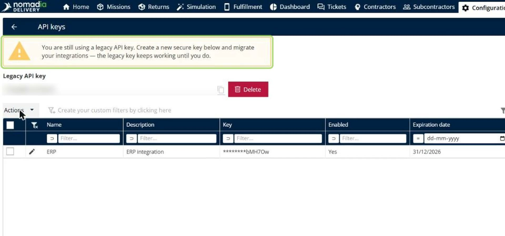

2. Click **Actions**, and then click **Add**.

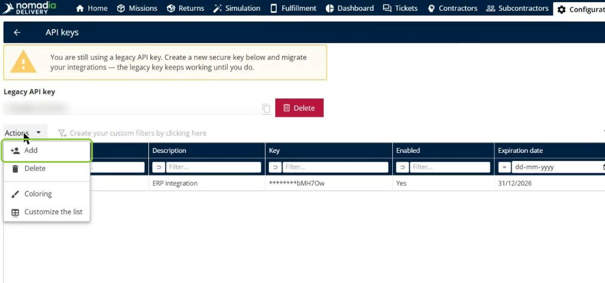

3. Enter a **Name** and a **Description** for the key.

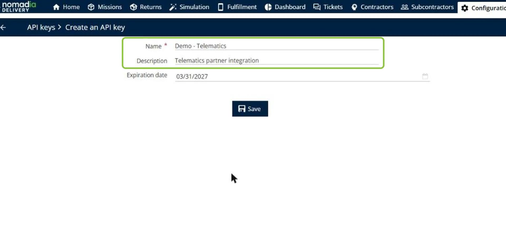

4. Optional: Choose an **Expiration date**.

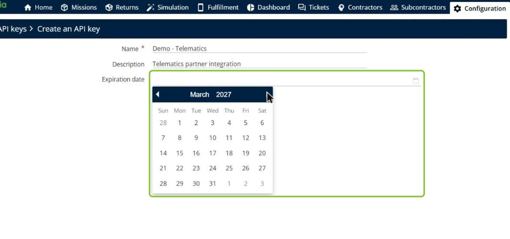

5. Click **Save**.

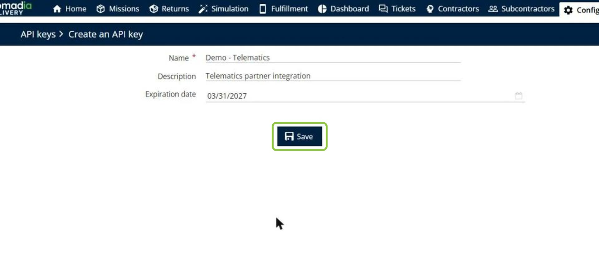

6. In the **API key created** pop-up, click **Copy** to copy the key, and then click **Close**.

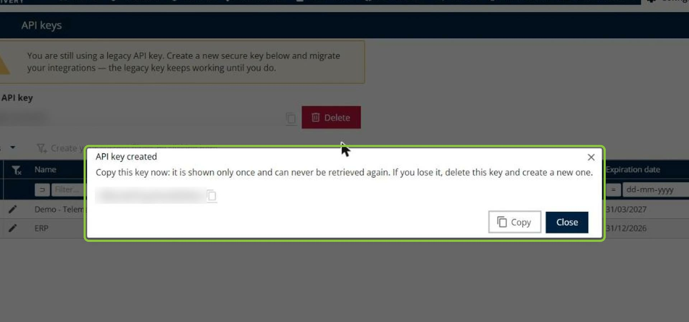

### Result

The key is added to the list. Only its last characters stay visible in the **Key** column.

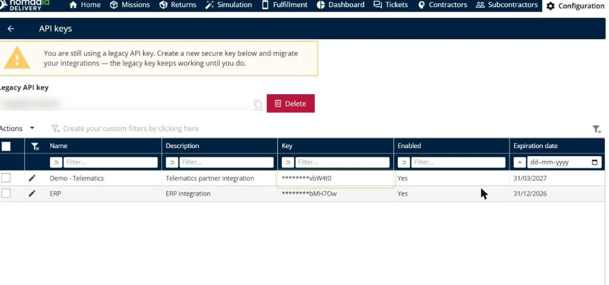

To connect several integrations, repeat these steps and create one key per integration.

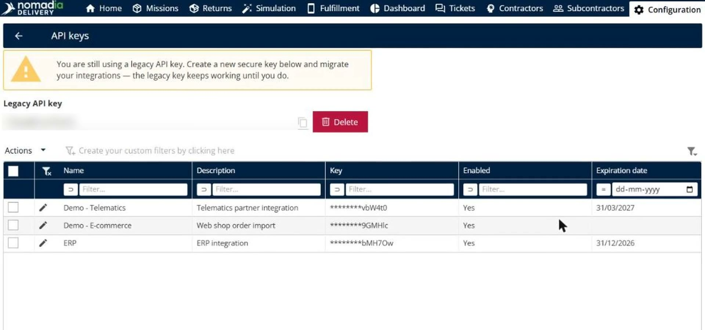

## Disable an API key

1. In the list of API keys, click the **pencil icon** next to the key.

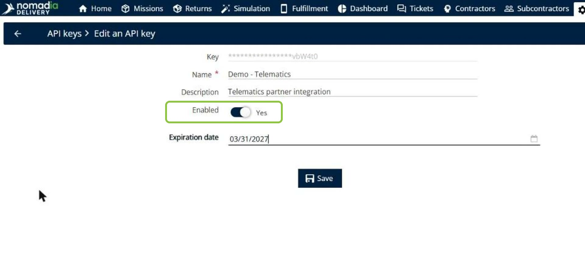

2. Turn off the **Enabled** switch so that it shows **No**.

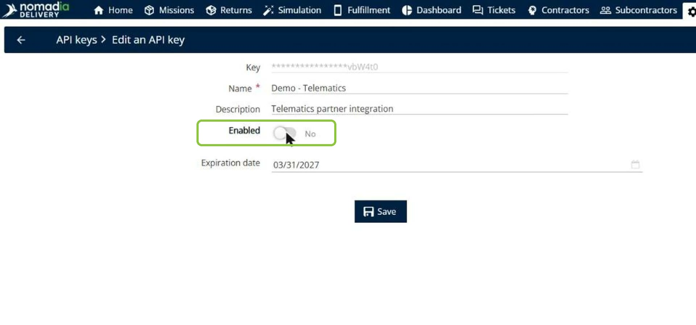

3. Click **Save**.

### Result

A notification confirms that the key was saved, and the **Enabled** column shows **No**. Requests that use this key are refused instantly.

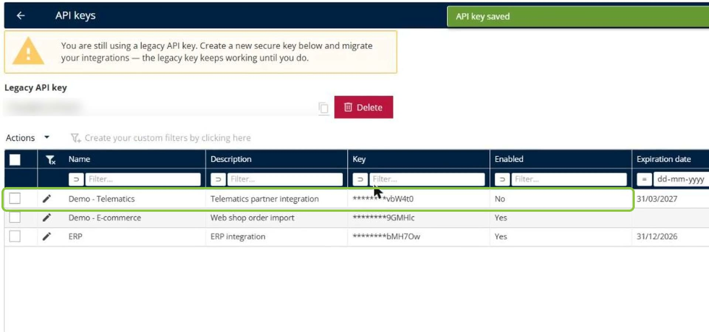

## Delete API keys

1. In the list of API keys, select the check boxes of the keys you want to delete.

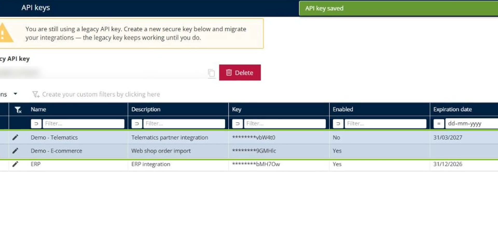

2. Click **Actions**, and then click **Delete**.
3. In the **Delete API key** pop-up, click **Yes**. The keys stop working immediately.

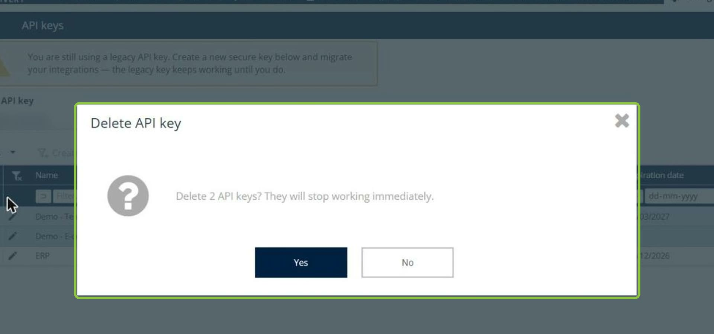

### Result

The keys are removed from the list. Your other integrations keep running with their own keys.

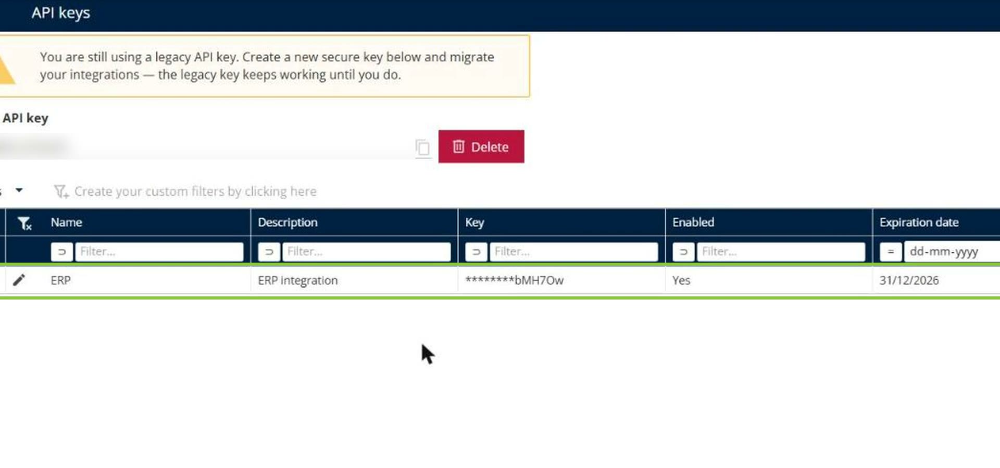

## Tips


**Copy the key when you create it**: The key is shown in full only once and can never be retrieved again. If you lose it, delete the key and create a new one.



**Migrate from the legacy key**: Create new secure keys, update your integrations, and then delete the legacy API key with its **Delete** button. The legacy key keeps working until you do.


## Related topics

* [Import Missions](8-6-missions/import-missions/README.md)
* [Control Address Sharing with Contractors](control-address-sharing-with-contractors.md)
