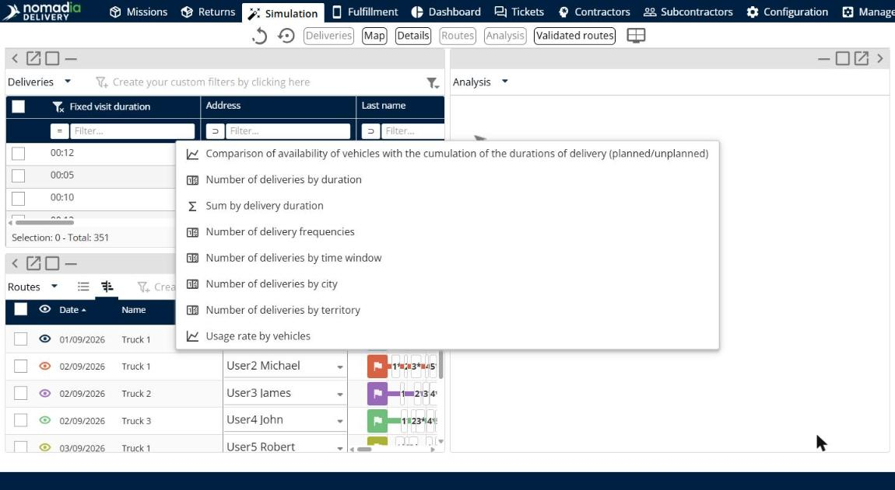

# Analyze the results

This page explains how to use the **Analysis** panel to access analysis charts and better understand the results.

## Before you begin

* Open a simulation. See [Simulation](simulation.md).

## Steps

1. Go to **Simulation**.
2. Click **Modify the display of panels**.
3. Drag **Analysis** onto the page.
4. Click the **Analysis** drop-down arrow.
5. Click a chart: **Comparison of availability of vehicles with the cumulation of the durations of delivery (planned/unplanned)**, **Number of deliveries by duration**, **Sum by delivery duration**, **Number of delivery frequencies**, **Number of deliveries by time window**, **Number of deliveries by city**, **Number of deliveries by territory** or **Usage rate by vehicles**.

## Result

The panel shows the chart you selected. Charts show **Planned deliveries** and **Unplanned deliveries** in different colors.

## Tips


**Go back to your layout**: Click **Undo layout changes** or **Reset layout** to remove the panel.


## Related topics

* [Simulation](simulation.md)
* [View route details](simulation-details.md)
