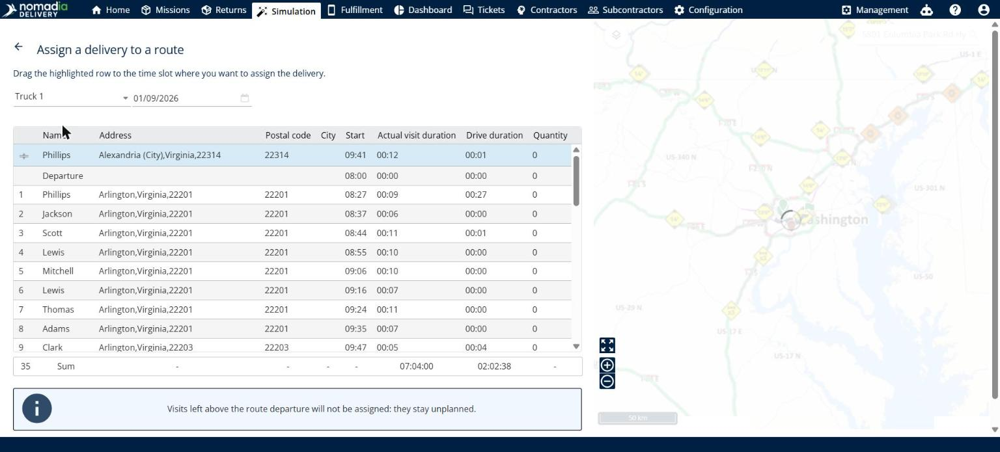

# Assign deliveries to a route

This page explains how to choose the route and the time slot for a delivery.

## Before you begin

* Open a simulation. See [Simulation](simulation.md).

## Steps

1. Go to **Simulation** > **Deliveries**.
2. Select the check box of the delivery you want to assign.
3. Click the **Deliveries** drop-down arrow, and then click **Assign deliveries**.
4. On the **Assign a delivery to a route** page, select the route in the first list, for example **Truck 1**, and the day in the date field.
5. Read the instruction at the top of the page: **Drag the highlighted row to the time slot where you want to assign the delivery.** The highlighted row is your delivery. The table lists the **Departure** and the stops of the route, with the **Name**, **Address**, **Postal code**, **City**, **Start**, **Actual visit duration**, **Drive duration** and **Quantity** of each stop. The last row shows the totals.
6. Drag the highlighted row to the position where you want the delivery in the route.
7. Click the back arrow at the top left to return to the simulation.

The map on the right of the page shows the route.

## Result

You can check the delivery in the **Planned**, **Assigned to**, **Planned day** and **Scheduled hour** columns of the **Deliveries** panel.

## Tips


**Deliveries above the departure**: Visits left above the route departure are not assigned. They stay unplanned.


## Related topics

* [Manage deliveries](simulation-deliveries.md)
* [Unassign deliveries](simulation-deliveries-unassign.md)
* [View a route](simulation-routes-view-route.md)
