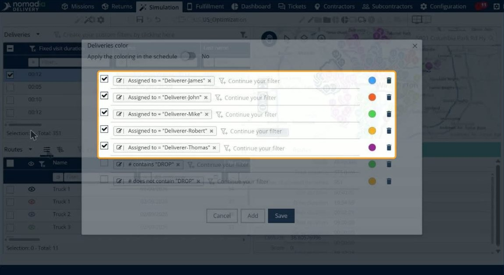

# Color the deliveries

This page explains how to use **Coloring** to apply color rules to the deliveries.

## When to use it

Use **Coloring** to give deliveries a color according to a rule, for example one color for each driver. The colors make it easier to see which deliveries belong together.

## Before you begin

* Open a simulation. See [Simulation](simulation.md).

## Steps

1. Go to **Simulation** > **Deliveries**.
2. Click the **Deliveries** drop-down arrow, and then click **Coloring**.
3. In the **Deliveries color** window, read the rules. Each line is a rule with a condition, for example **Assigned to = "Deliverer-James"**, and a color.
4. Select the check box at the start of a rule to use it.
5. To change the condition of a rule, edit the condition in the line, or type in **Continue your filter**.
6. To delete a rule, click the trash icon at the end of the line.
7. To create a rule, click **Add**.
8. To show the colors in the schedule as well, turn on **Apply the coloring in the schedule**.
9. Click **Save**.

Click **Cancel** to close the window without saving.

## Options and fields

| Option or field | What it does | Notes |
|---|---|---|
| **Apply the coloring in the schedule** | Shows the colors in the schedule. | The switch shows **No** by default. |
| Rule check box | Turns a rule on or off. | Only the selected rules color the deliveries. |
| Rule condition | Defines which deliveries get the color, for example **Assigned to = "Deliverer-John"**. | Add more conditions in **Continue your filter**. |
| Color dot | Shows the color of the rule. | |
| Trash icon | Deletes the rule. | |
| **Add** | Adds a new rule. | |
| **Save** | Saves the rules. | |
| **Cancel** | Closes the window without saving. | |

## Result

The deliveries that match a selected rule get the color of that rule.

## Related topics

* [Manage deliveries](simulation-deliveries.md)
* [Customize the deliveries list](simulation-deliveries-customize-list.md)
