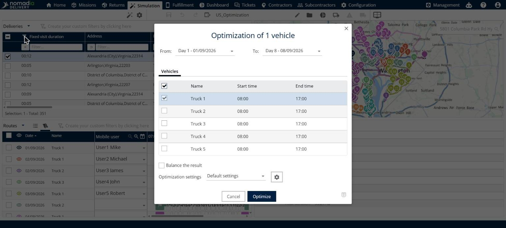

# Optimize deliveries

This page explains how to optimize the selected deliveries in a simulation.

## Before you begin

* Open a simulation. See [Simulation](simulation.md).
* Make sure your user profile has the **Optimization** right. See [Web - Roles and Rights](../7-5-manage-users/web-roles-and-rights.md).

## When to use it

Use **Optimize** to plan the selected deliveries automatically. You choose the dates and the vehicles, you can balance the workload, and you pick a settings profile.

## Steps

1. Go to **Simulation** > **Deliveries**.
2. Select the check boxes of the deliveries you want to optimize.
3. Click the **Deliveries** drop-down arrow, and then click **Optimize**. You can also click the **Optimize** button in the toolbar.
4. In the **Optimization** window, select the first and the last day of the period in **From** and **To**, for example **Day 1 - 01/09/2026** and **Day 8 - 08/09/2026**.
5. On the **Vehicles** tab, select the vehicles to use. The list shows the **Name**, **Start time** and **End time** of each vehicle. Select the check box in the header row to select all vehicles.
6. Optional: select **Balance the result**.
7. In **Optimization settings**, select the configuration to use, for example **Default settings**. To review or change the settings, click the gear button. See [Configure the optimization settings](simulation-optimization-settings.md).
8. Click **Optimize**.

## Options and fields

| Option or field | What it does | Notes |
|---|---|---|
| **From** and **To** | Set the first and the last day of the period. | For example **Day 1 - 01/09/2026** and **Day 8 - 08/09/2026**. |
| **Vehicles** | Lists the vehicles with their **Name**, **Start time** and **End time**. | Select the check box of each vehicle to use. The header check box selects all vehicles. |
| **Balance the result** | Balances the workload between the vehicles. | Not selected by default. |
| **Optimization settings** | Selects the settings profile to use. | The default value is **Default settings**. The gear button opens the settings. |
| **Cancel** | Closes the window without optimizing. | |
| **Optimize** | Starts the optimization. | |

## Result

The window shows the two steps of the optimization, **1 - Preparation of the optimization** and **2 - Optimization**, and then **Loading the result...**. The routes are recalculated in seconds and the **Details** panel updates its totals. For example, **Total distance** goes from 598 km to 575 km.

When the optimization finishes, the **Optimization results** window opens. See [Simulation](simulation.md). The message **Saving simulation** appears at the bottom of the page while the simulation is saved.

## Tips


**Leave without optimizing**: Click **Cancel** to close the window without starting an optimization.


## Related topics

* [Manage deliveries](simulation-deliveries.md)
* [Configure the optimization settings](simulation-optimization-settings.md)
* [Order a single route](simulation-deliveries-single-route-ordering.md)
