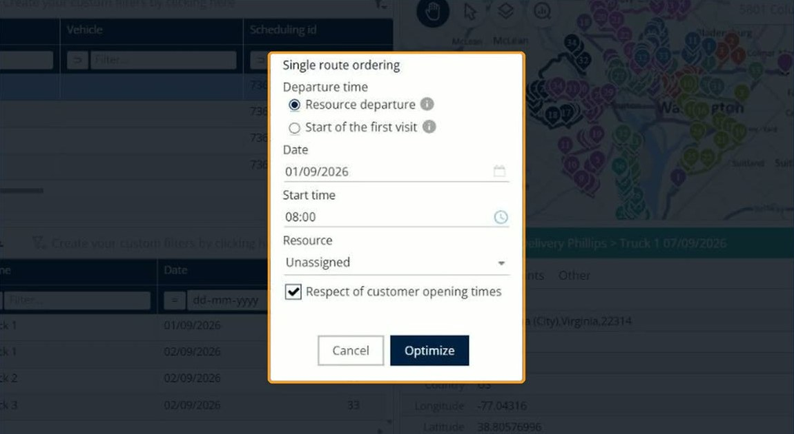

# Order a single route

This page explains how to use **Single route ordering** to build one optimized sequence for the deliveries you select.

## When to use it

Use **Single route ordering** when you want the selected deliveries on one route, in the best order. The sequence starts from the departure of the resource or from the first visit, and it respects the opening times of your customers.

## Before you begin

* Open a simulation. See [Simulation](simulation.md).
* Select the deliveries you want to order.

## Steps

1. Go to **Simulation** > **Deliveries**.
2. Select the check boxes of the deliveries you want to order.
3. Click the **Deliveries** drop-down arrow, and then click **Single route ordering**.
4. In **Departure time**, select **Resource departure** or **Start of the first visit**.
5. In **Date**, select the day of the route, for example **01/09/2026**.
6. In **Start time**, select the time the route starts, for example **08:00**.
7. In **Resource**, select the resource that drives the route. The default value is **Unassigned**.
8. Keep **Respect of customer opening times** selected to respect the opening times of your customers.
9. Click **Optimize**.

Click **Cancel** to close the window without ordering the route.

## Options and fields

| Option or field | What it does | Notes |
|---|---|---|
| **Resource departure** | Starts the sequence from the departure of the resource. | Selected by default. Click the information icon next to it for more details. |
| **Start of the first visit** | Starts the sequence at the first visit. | Click the information icon next to it for more details. |
| **Date** | Sets the day of the route. | Use the calendar icon to pick a date. |
| **Start time** | Sets the time the route starts. | Use the clock icon to pick a time. |
| **Resource** | Sets the resource for the route. | The default value is **Unassigned**. |
| **Respect of customer opening times** | Respects the opening times of your customers when the sequence is built. | Selected by default. |

## Result

The selected deliveries are ordered on a single route.

If the action only concerns locked routes, nothing changes and the message **The action had no effect as it concerns only locked routes.** appears in the top right corner. To change a locked route, unlock it first. See [Lock and unlock routes](simulation-routes-lock-unlock.md).

## Related topics

* [Manage deliveries](simulation-deliveries.md)
* [Optimize deliveries](simulation-deliveries-optimize.md)
* [Lock and unlock deliveries](simulation-deliveries-lock-unlock.md)
