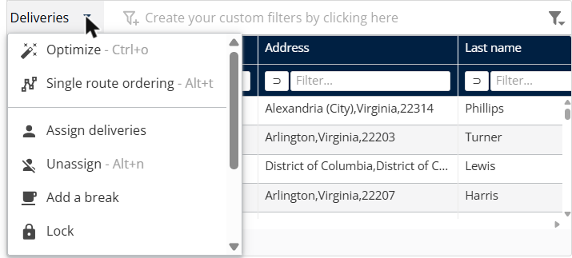

# Manage deliveries

This page explains how to use the **Deliveries** panel to find deliveries in a simulation and change how they are planned.

## Before you begin

* Open a simulation. See [Simulation](simulation.md).

## Columns

The panel shows one row for each delivery. By default the columns include **Fixed visit duration**, **Address**, **Last name**, **#**, **Type**, **Vehicle**, **Scheduling id**, **Compatibility with the resources**, **Longitude / X**, **Latitude / Y**, **Postal code**, **Country**, **Identifier**, **Planned**, **Locked**, **Visit duplicated by frequency**, **Reason**, **Assigned to**, **Planned day** and **Scheduled hour**. To choose other columns, see [Customize the deliveries list](simulation-deliveries-customize-list.md).

## Steps

1. Go to **Simulation** > **Deliveries**.
2. Type a value in a column's **Filter…** box to filter the list.
3. Click the comparison operator next to the filter box, for example **equal to** or **contains**, to change how the filter works.
4. Select the check boxes of the deliveries you want to change.
5. Click the **Deliveries** drop-down arrow.
6. Click an action. Each action is described in its own topic, listed under **Features**.

## Features

* [Optimize deliveries](simulation-deliveries-optimize.md): Optimize the selected deliveries over a period, with the vehicles you choose.
* [Order a single route](simulation-deliveries-single-route-ordering.md): Order the selected deliveries on a single route.
* [Assign deliveries to a route](simulation-deliveries-assign.md): Choose the route and the time slot for a delivery.
* [Unassign deliveries](simulation-deliveries-unassign.md): Remove the selected deliveries from their routes.
* [Add a break](simulation-deliveries-add-break.md): Add a break to a route.
* [Lock and unlock deliveries](simulation-deliveries-lock-unlock.md): Keep deliveries as they are, or make them changeable again.
* [Delete deliveries](simulation-deliveries-delete.md): Remove the selected deliveries from the simulation.
* [Customize the deliveries list](simulation-deliveries-customize-list.md): Choose the columns, change the colors and build filters.

## Result

The footer shows how many deliveries you selected and the total, for example **Selection: 1 - Total: 351**.

## Related topics

* [Simulation](simulation.md)
* [Manage routes](simulation-routes.md)
* [View the map](simulation-map.md)
