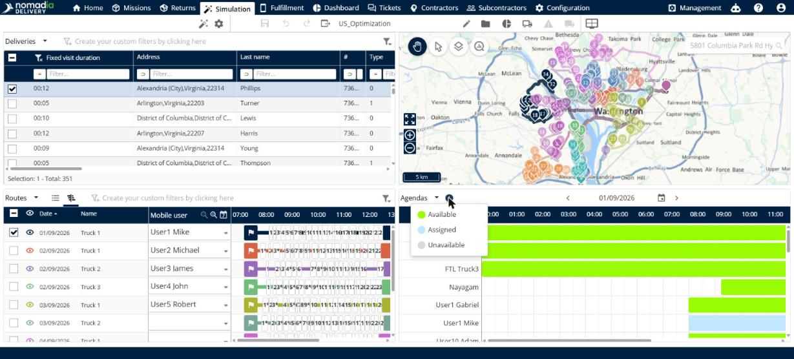

# View agendas

This page explains how to use the **Agendas** view to see when your resources are available.

## Before you begin

* Open a simulation. See [Simulation](simulation.md).

## Steps

1. Go to **Simulation** > **Details**.
2. Click the drop-down arrow next to the panel title, and then click **Agendas**.
3. Read the timeline. Each row is a resource, and the hours of the day are at the top.
4. To change the day, click the arrows on each side of the date, or click the calendar icon.
5. To see the meaning of the colors, click the information icon next to the panel title.

## Result

The colors show **Available** (green), **Assigned** (blue) and **Unavailable** (gray).

## Related topics

* [View route details](simulation-details.md)
* [Manage routes](simulation-routes.md)
