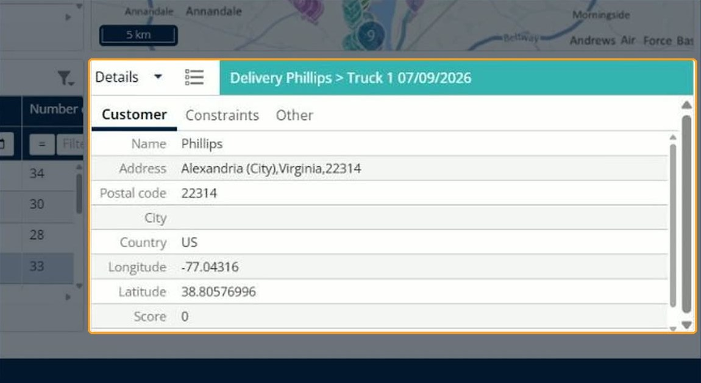

# View route details

This page explains how to use the **Details** panel to see the totals for your routes.

## Before you begin

* Open a simulation. See [Simulation](simulation.md).

## Steps

1. Go to **Simulation** > **Details**.
2. Click the **Details** drop-down arrow.
3. Click **Details** to see the totals, or **Agendas** to see the agendas. See [View agendas](simulation-details-agendas.md).
4. To see the totals of one route, open the route in the **Routes** panel. See [View a route](simulation-routes-view-route.md).

To see the information of one delivery, click the delivery in the **Deliveries** panel. The panel title changes to the delivery and its route, for example **Delivery Phillips > Truck 1 07/09/2026**, and the information is shown on the **Customer**, **Constraints** and **Other** tabs. The **Customer** tab shows **Name**, **Address**, **Postal code**, **City**, **Country**, **Longitude**, **Latitude** and **Score**.

## Features

* [View agendas](simulation-details-agendas.md): See when your resources are available, assigned or unavailable.

## Result

The **Details** view shows **Name**, **Total distance**, **Number of planned deliveries**, **Visit duration**, **Drive duration**, **Wait duration**, **Rest duration**, **Delay duration**, **Overtime duration** and **Total duration**. When no route is selected, **Name** shows **All routes**. When you open a route, the panel shows that route on the **Information**, **Essential** and **Other** tabs.

## Related topics

* [Simulation](simulation.md)
* [Manage routes](simulation-routes.md)
* [View a route](simulation-routes-view-route.md)
