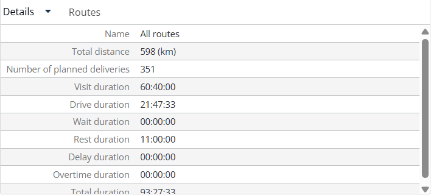

# View route details

This page explains how to use the **Details** panel to see the totals for your routes.

## Before you begin

* Open a simulation. See [Simulation](simulation.md).

## Steps

1. Go to **Simulation** > **Details**.
2. Click the **Details** drop-down arrow.
3. Click **Details** to see the totals, or **Agendas** to see the agendas.
4. Click **Routes** to see the routes. [TODO: Describe what the Routes tab in this panel shows]

## Result

The **Details** view shows **Name**, **Total distance**, **Number of planned deliveries**, **Visit duration**, **Drive duration**, **Wait duration**, **Rest duration**, **Delay duration**, **Overtime duration** and **Total duration**. When no route is selected, **Name** shows **All routes**. [TODO: Describe what the Agendas view shows]

## Related topics

* [Simulation](simulation.md)
* [Manage routes](simulation-routes.md)
