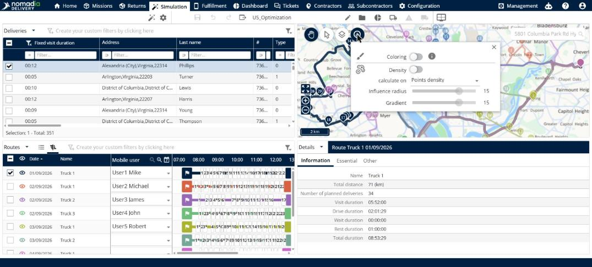

# Use graphical information

This page explains how to use **Graphical information** to color the map or show the density of the points on it.

## Before you begin

* Open a simulation. See [Simulation](simulation.md).

## Steps

1. Go to **Simulation** > **Map**.
2. Click **Graphical information**.
3. Turn on **Coloring** to color the map. Click the information icon next to it to see more about this option.
4. Turn on **Density** to show the density of the points on the map.
5. For **Density**, set the following options:
   * **calculate on**: select what the density is calculated on, for example **Points density**.
   * **Influence radius**: move the slider.
   * **Gradient**: move the slider.

## Result

The map shows the options you turned on.

## Related topics

* [View the map](simulation-map.md)
* [Choose what the map shows](simulation-map-objects-visibility.md)
