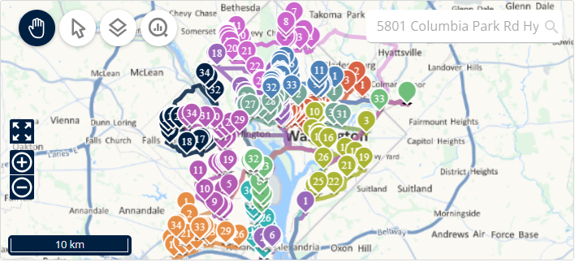

# View the map

This page explains how to use the **Map** panel to see where your deliveries and routes are.

## Before you begin

* Open a simulation. See [Simulation](simulation.md).

## Steps

1. Go to **Simulation** > **Map**.
2. Click **Navigation** to move around the map.
3. Click **Selection** to select deliveries on the map.
4. Click **Objects visibility** to choose what the map shows.
5. Click **Graphical information** to see more details on the map.
6. Type an address in the search box to find a location.
7. Use the zoom-in and zoom-out buttons to change the zoom level.

## Result

The map shows each route in its own color. Numbered markers show the order of the deliveries on each route.

## Tips


**Hide a route**: In the **Routes** panel, click the eye icon next to a route. [TODO: Confirm this hides the route on the map]


## Related topics

* [Simulation](simulation.md)
* [Manage deliveries](simulation-deliveries.md)
* [Manage routes](simulation-routes.md)
