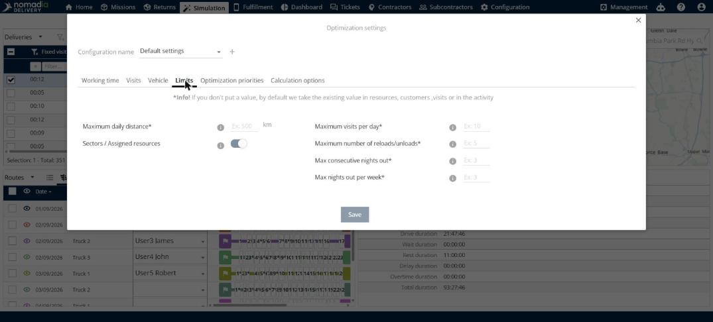
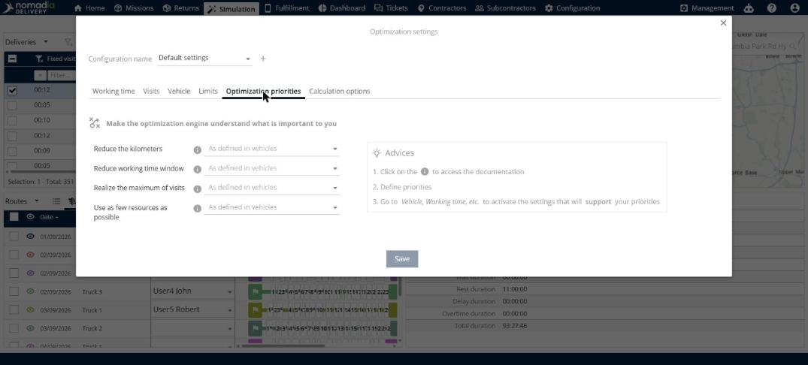

# Configure the optimization settings

This page explains how to use the **Optimization settings** window to define the parameters that an optimization uses.

## Before you begin

* Open a simulation. See [Simulation](simulation.md).
* Make sure your user profile has the **Modify optimization settings** right. See [Web - Roles and Rights](../7-5-manage-users/web-roles-and-rights.md).

## Steps

1. Open the **Optimization** window. See [Optimize deliveries](simulation-deliveries-optimize.md).
2. Click the gear button next to **Optimization settings**.
3. In **Configuration name**, select a configuration, or click **+** to create a new one.
4. Open a tab and enter your values. The tabs are described below.
5. Click **Save**.

If you leave a field empty, the optimization uses the value that is already defined for the resources, the customers, the deliveries or the activity.

## Working time

* **Working duration of vehicles**: **Daily duration** and **Weekly duration**.
* **Start and end of the day**: **Fixed start time**, **Start at first visit**, **End at last visit** and **Overtime** (a switch and a number of minutes).
* **At customer**: **Opening times** (a switch), **End visit before closing time**, **Delivery duration** (in minutes) and the minutes you take to load or unload each product.
* **Driving time regulation**: **Enable**.

## Visits

* **Ignore outsourcing cost**: a switch.

## Vehicle

* **Vehicle type**: **Means of transportation**, **Fuel type** and **Capacity adjustment** (a slider from -50% to +50%).
* **Speed**: **Vehicle speed** and **Variable speed based on time**.
* **Route**: **Calculate the route**, **Allow tolls**, **Allow tunnels**, **Allow bridges**, **Use forbidden transit areas** and **Others exclusion criteria**.

## Limits

* **Maximum daily distance** (in km).
* **Sectors / Assigned resources**: a switch.
* **Maximum visits per day**.
* **Maximum number of reloads/unloads**.
* **Max consecutive nights out** and **Max nights out per week**.

## Optimization priorities

Use this tab to tell the optimization what is important to you. Set a value for each priority:

* **Reduce the kilometers**.
* **Reduce working time window**.
* **Realize the maximum of visits**.
* **Use as few resources as possible**.

The **Advices** box suggests three steps: click the information icon to see the documentation, define your priorities, and then go to tabs such as **Vehicle** and **Working time** to activate the settings that support your priorities.

## Calculation options

* **Optimization duration**: **Maximum optimization duration** (in minutes) and **Automatic stop of the optimization**.
* **Optimization**: **Optimization engine** and **Associate deliveries at same locations**.

## Result

Your values are saved in the configuration you selected.

## Tips


**Information icons**: Click the information icon next to a setting to see more about it.


## Related topics

* [Optimize deliveries](simulation-deliveries-optimize.md)
* [Manage deliveries](simulation-deliveries.md)
