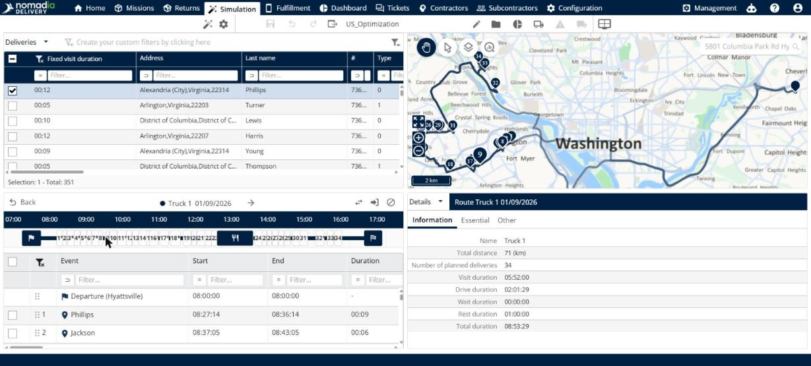

# View a route

This page explains how to open one route to see its stops, its times and its totals.

## Before you begin

* Open a simulation. See [Simulation](simulation.md).

## Steps

1. Go to **Simulation** > **Routes**.
2. Click the row of a route. The panel shows the route, and the **Details** panel shows its totals.
3. Read the title at the top of the panel. It shows the name and the date of the route, for example **Truck 1 01/09/2026**. Click the arrow next to it to go to the next route.
4. Read the timeline. It starts with the departure flag, shows the numbered stops and the break icon, and ends with the arrival flag.
5. Read the table below the timeline. It lists the events of the route in order, with their **Start**, **End** and **Duration**. The first event is the **Departure**, followed by the stops.
6. Use the buttons at the top right of the panel:
   * **Reverse**: reverse the order of the route.
   * **Assign deliveries**: assign deliveries to the route.
   * **Unassign**: unassign deliveries from the route.
7. Click **Back** to return to the list of routes.

## Result

The **Details** panel shows the route on three tabs: **Information**, **Essential** and **Other**. The **Information** tab shows the **Name**, **Total distance**, **Number of planned deliveries**, **Visit duration**, **Drive duration**, **Wait duration**, **Rest duration** and **Total duration** of the route.

## Related topics

* [Manage routes](simulation-routes.md)
* [View route details](simulation-details.md)
* [Assign deliveries to a route](simulation-deliveries-assign.md)
