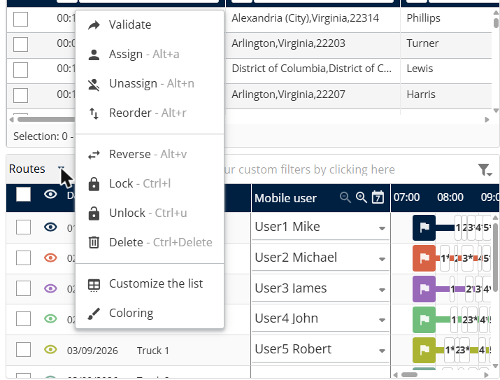

# Manage routes

This page explains how to use the **Routes** panel to review and change the routes in a simulation.

## Before you begin

* Open a simulation. See [Simulation](simulation.md).

## Steps

1. Go to **Simulation** > **Routes**.
2. Click **Route view** to see the routes as a list, or **Gantt view** to see them on a timeline.
3. Select a deliverer in the **Mobile user** list for each route.
4. Select the check boxes of the routes you want to change.
5. Click the **Routes** drop-down arrow.
6. Click an action: **Validate**, **Assign**, **Unassign**, **Reorder**, **Reverse**, **Lock**, **Unlock** or **Delete**.
7. [TODO: Describe what the user does after choosing each action]

## Result

Each route shows its **Date**, **Name** and **Mobile user**. In **Gantt view**, the timeline shows the deliveries of each route by hour. Routes you validate show in the **Validated routes** panel.

## Tips


**Keyboard shortcuts**: **Assign** is Alt+A, **Unassign** is Alt+N, **Reorder** is Alt+R, **Reverse** is Alt+V, **Lock** is Ctrl+L, **Unlock** is Ctrl+U and **Delete** is Ctrl+Delete.



**Customize the list**: In the **Routes** menu, click **Customize the list** to choose your columns or **Coloring** to change route colors.


## Related topics

* [Simulation](simulation.md)
* [View validated routes](simulation-validated-routes.md)
* [View route details](simulation-details.md)
