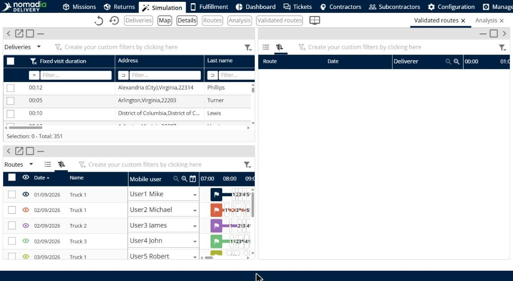

# View validated routes

This page explains how to show the **Validated routes** panel to see the routes you validated.

## Before you begin

* Open a simulation. See [Simulation](simulation.md).
* Validate at least one route. See [Manage routes](simulation-routes.md).

## Steps

1. Go to **Simulation**.
2. Click **Modify the display of panels**.
3. Drag **Validated routes** onto the page.
4. Click the list icon to see the routes as a list, or the Gantt icon to see them on a timeline.

## Result

The panel shows each validated route with its **Route**, **Date** and **Deliverer**. The list is empty when no route is validated. [TODO: Confirm what the user can do with a validated route]

## Tips


**Switch panels**: When you add more than one panel in the same place, click the panel name at the top right, for example **Validated routes** or **Analysis**, to switch between them.


## Related topics

* [Simulation](simulation.md)
* [Manage routes](simulation-routes.md)
